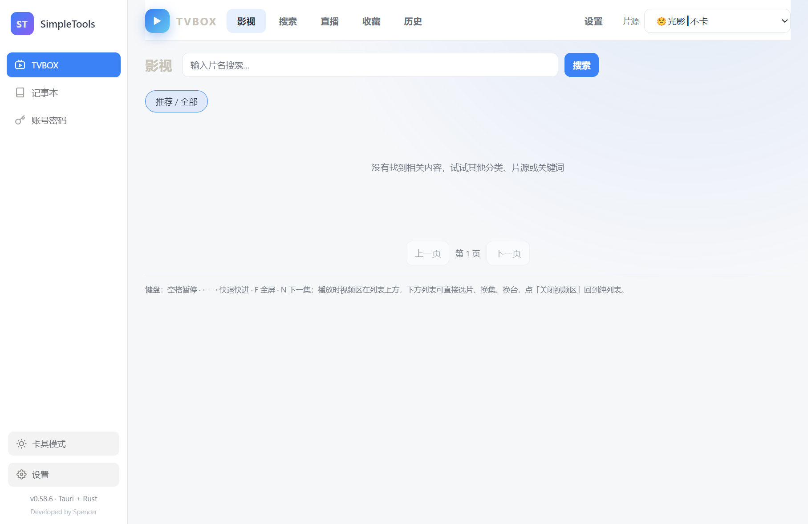

# SimpleTools TVBOX

SimpleTools TVBOX 是 SimpleTools 的影音增强版本，采用 Windows 鼠标与键盘交互，不需要遥控器或 Android 后台环境。

## 功能介绍

- TVBOX：首页、分类筛选、多源搜索、详情、选集、收藏和观看历史。
- 片源兼容：JSON/XML、源码 JS、内置 Python、JAR、DEX JAR 和原始 DEX。
- 饭太硬/玩偶：本机适配、网盘详情、封面、资源名称和播放链路。
- 网盘：夸克、UC、百度和阿里云盘，支持手机扫码登录。
- 播放器：内置 libmpv、硬件解码、真实分辨率/FPS、4K/8K、字幕、音轨、进度、倍速和系统真全屏。
- 直播：动态更新 M3U、频道分组、搜索、多线路切换和失效自动换源。
- 点播与直播分离：直播不显示字幕、点播进度和快进等无关控制。
- 标准工具：同时包含记事本、账号密码、JSON、文本对比、Markdown、数据库和网络调试工具。

## 更新日志

版本变化统一维护在 [更新日志](CHANGELOG.md)。
