# SimpleTools

常用工具合集 —— 基于 **Tauri 2 + Rust** 的 Windows 桌面小工具，界面简约、开箱即用。
安装包仅约 1.4 MB，默认浅色主题，支持深色 / 深浅混搭 / 卡其色主题；侧边栏功能与样式可在「应用设置 → 功能显示」中自定义。

## 效果预览

### JSON 格式化（自动去转义 + 历史记录）

从日志、代码里复制的被转义字符串（`{\"a\":1}`）可直接粘贴，自动还原并格式化，输入 / 输出均可一键复制；格式化结果可切换为可折叠的树形视图（「树形视图」开关，支持展开 / 折叠全部，JSON 过大自动退回文本显示）；格式化 / 压缩自动留存历史记录（最多 50 条），点击记录即可恢复当时的输入与结果，支持单条删除、多选批量删除与一键清空（下图为历史记录多选模式）。

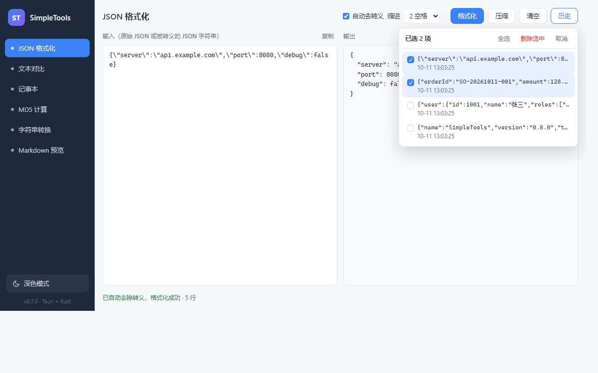

### 文本对比（左侧绿色 / 右侧红色）

按行 + 字符级对比，差异处左侧绿色、右侧红色标记，带行号与差异统计；支持「自动提取 JSON」（从两侧文本中提取 JSON 片段参与对比，兼容被转义内容）与「JSON 树形结构」对比（两侧并排折叠树，差异节点高亮：绿 = 左侧独有 / 旧值，红 = 右侧独有 / 新值）；左侧文本、右侧文本与对比结果均支持一键复制（结果输出完整文本，差异行以 `-` / `+` 标记）；每次对比自动留存历史记录，点击记录即可恢复左右文本并重新对比。

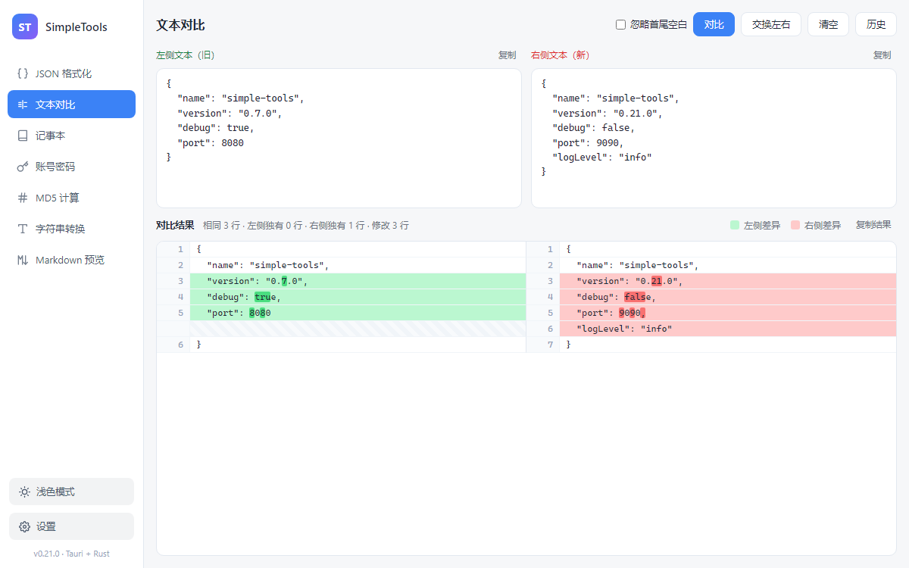

### 记事本（普通笔记 / Markdown 笔记 / 任务笔记 + 本地缓存 + 拖动排序 + 双模式搜索）

左侧记录列表、右侧标题与正文编辑，自动保存到本地；新建记录时可选择「普通笔记」「Markdown 笔记」或「任务笔记」，列表中不同类型带对应图标（普通笔记为文档图标、Markdown 为 M↓ 徽标、任务笔记为清单图标）；普通笔记为与富文本任务同款的所见即所得编辑器（工具栏支持加粗 / 斜体 / 下划线 / 有序与无序列表 / 插入本地图片，图片同样自动收纳到数据目录 `images/` 文件夹并随数据迁移与备份）；Markdown 笔记的编辑器为左编辑右实时预览分屏（与 Markdown 预览面板共用同一渲染器，输入即时渲染；预览区支持目录导航与关键字搜索：高亮 / 计数 / 上下跳转，可勾选「同步源文件」让左侧源码随命中同步滚动）；任务笔记以「任务组」形式管理多条任务：每条任务可勾选记录完成 / 未完成状态（顶部显示「已完成 x / y」计数），支持自动递增序号（默认开启、可取消），任务分「简单任务」（纯文本，点击行内编辑）与「富文本任务」（必填标题 + 所见即所得富文本内容，支持加粗 / 斜体 / 下划线 / 有序与无序列表 / 插入本地图片——图片自动收纳到数据目录 `images/` 文件夹并以相对路径引用，随数据存储位置迁移与一键备份导出，经 asset 协议加载显示）；支持拖动排序、双模式搜索（默认「标题」按记录标题实时过滤，点搜索框左侧的双向箭头图标切换「内容」按正文模糊匹配；任务笔记按任务级匹配 —— 简单任务匹配文本、富文本任务匹配标题与内容，内容命中显示「标题 + 内容匹配」标记、点击进入详情并高亮命中词；命中片段高亮，内容模式展示命中摘要行），删除弹窗确认、一键复制正文、导出为 JSON / TXT（单条 / 批量，自选目标文件夹），以及批量操作（多选 / 全选 / 批量删除 / 批量导出，下图为批量选择模式）。


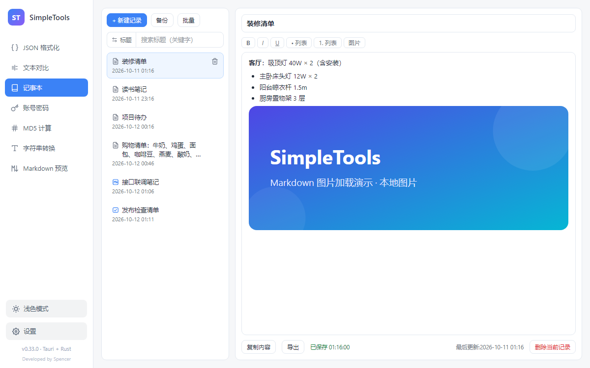

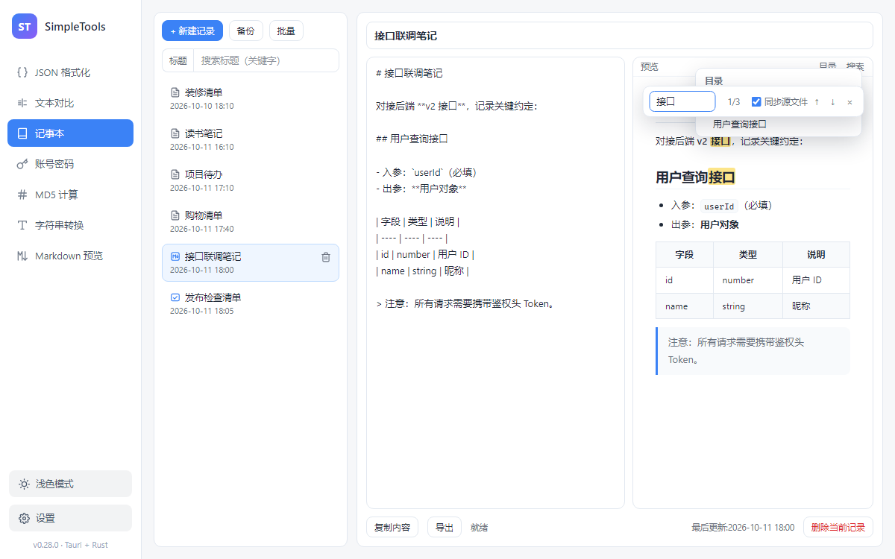

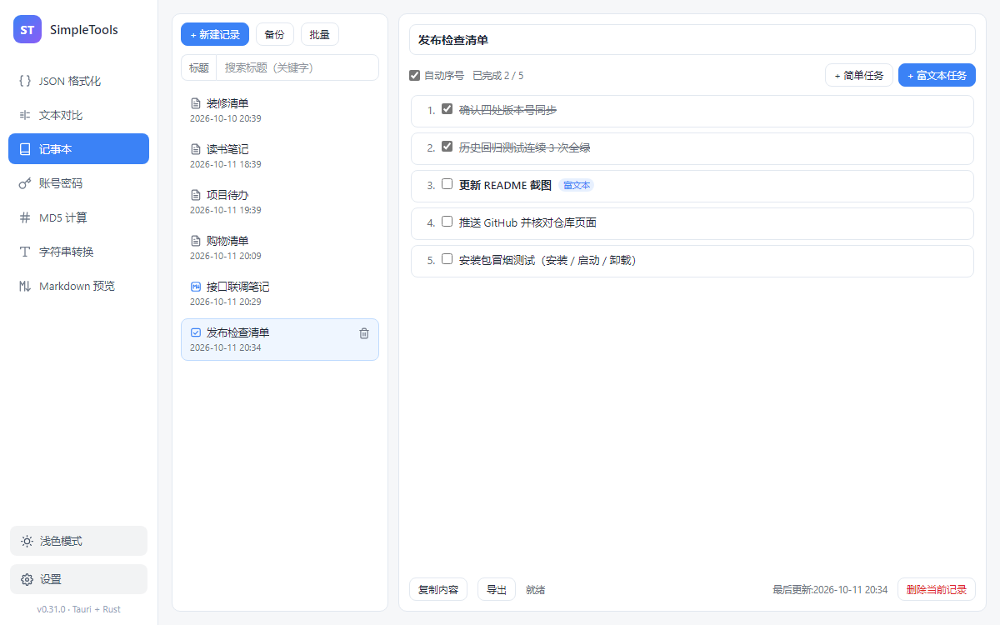


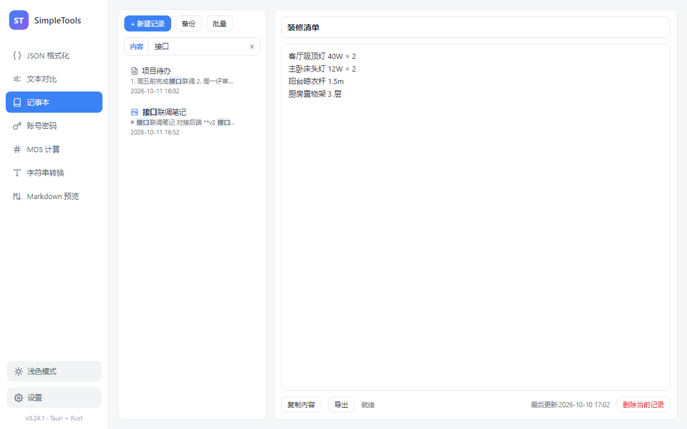

### 账号密码（分组管理 + 备注 + 本地加密 + 单独 / 一键复制 + 三条件搜索 + 命中高亮 + 批量导出）

按分组（标题）管理账号密码，组名可直接编辑，组内账号、密码与备注行内修改、自动保存到本地（备注可选填；Windows DPAPI 加密存储，与当前电脑用户绑定，防明文落盘）；每条记录支持单独复制账号 / 复制密码，也可一键复制（账号 + 密码）；密码默认遮蔽，可一键显示 / 隐藏；支持按分组名 / 账号 / 备注三条件模糊搜索（跨分组匹配，结果显示所属分组名，命中同一目标自动合并为一条，分组名、账号、备注中的命中片段均高亮标亮方便区分，结果可直接复制）；删除分组与条目均有弹窗确认；支持批量导出 —— 当前分组 / 全部账号可导出为 TXT 或表格 CSV（含备注列，自选文件夹，含 UTF-8 BOM 兼容 Windows 记事本与 Excel）。

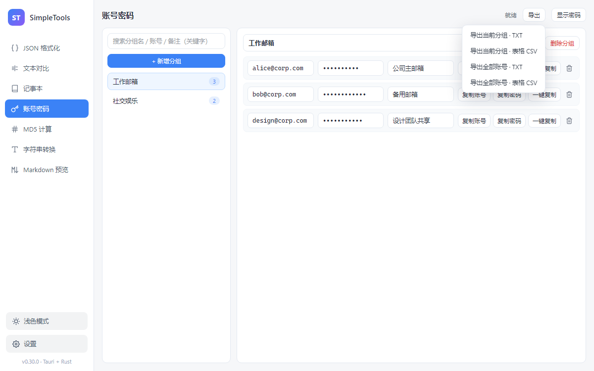

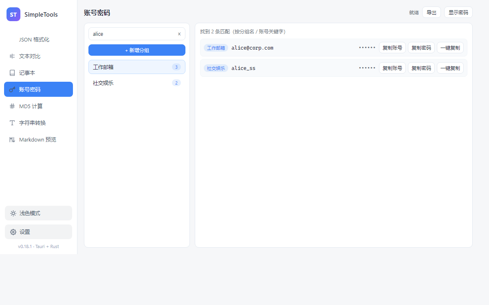

### 应用设置（功能显示 + 账号密码安全锁 + 数据存储位置 + 存储说明 + 数据导入导出 / 恢复）

弹窗为横版左右布局：左侧为分类导航（功能显示 / 安全 / 存储），点击切换右侧内容区，每次打开默认回到「功能显示」。

「功能显示」分类可自定义侧边栏：「侧边栏导航样式」支持「图标 + 名称」（默认）/「仅图标」（侧边栏缩窄为 64px，按钮悬停显示功能名）/「仅名称」三种模式；「显示的功能」列出全部功能，默认仅显示「记事本」与「账号密码」两个主要功能，其余功能勾选后即出现在侧边栏（取消勾选暂时用不到的功能后立即从侧边栏隐藏，数据与配置保留，重新勾选即恢复）—— 至少保留一个功能，正在使用的功能被隐藏时自动切换到第一个可见功能；所有选择即时生效并自动记忆。

侧边栏底部「设置」进入应用设置；可开启「查看账号密码需 Windows Hello 验证」—— 开启后进入「账号密码」需先通过 PIN / 指纹 / 面容等 Windows Hello 方式验证（系统弹窗接管），开关的开启 / 关闭同样需要验证（取消或验证失败自动回滚）；电脑未配置 Windows Hello 时给出提示，引导前往 Windows 设置创建 PIN 或录入指纹。

「数据存储位置」显示当前数据目录并支持更改 —— 点击「更改位置」选择文件夹后，记事本 / 账号密码 / 历史记录 / 富文本图片数据自动迁移到新位置（逐文件复制并校验，原位置文件保留），完成后应用自动重新加载；自定义位置下可一键「恢复默认」切回应用默认数据目录。

「数据存储说明」弹窗列出各数据文件 / 目录的用途、当前存放位置与实际大小（尚未生成的标注「未生成」）—— 记事本 / 账号密码 / 历史记录 / 记事本备份 / 富文本图片（`images/` 子目录，统计图片总大小）位于当前数据目录，应用配置固定于默认目录并特别标注；路径由后端实时解析，切换数据存储位置后同步更新。每个条目提供「打开」按钮，在资源管理器中直接定位选中对应文件（图片目录直接打开该目录；尚未生成时打开所在目录），顶部「打开目录」一键打开当前数据目录，方便备份与查看。

「数据导入导出」支持一键备份全部用户数据与应用配置：「导出」可选择保存为 ZIP 压缩包（自选文件名与位置）或导出到文件夹（自动创建 `SimpleTools_backup_时间戳` 子文件夹）；「导入」支持从 ZIP 压缩包或文件夹导入，并可选两种方式 —— 「覆盖导入」（整文件替换，与旧版一致）或「合并导入」（保留当前数据合并：笔记重名自动改名为「名称-1」、同名分组自动归一、账号记录按账号去重、历史记录按内容去重、图片同名同内容跳过 / 同名不同内容自动改名并更新笔记中的图片引用，确认弹窗展示本次合并统计）。两种方式的确认弹窗都会给出备份提示（本次自动备份的完整路径）与恢复指引（如何找回旧数据），合并导入另有风险提示；执行时先把当前数据备份到数据目录下的 `import-backup-时间戳` 文件夹再写入，完成后应用自动重新加载。备份涵盖记事本 / 账号密码 / 历史记录 / 记事本备份 / 富文本图片（`images/` 目录）与应用配置（`settings.json` 位于默认目录，一并备份），换机导入时若配置中的原数据目录不存在，自动回退默认目录；账号密码密文经 Windows DPAPI 加密与当前电脑用户绑定，仅能在导出时的同一 Windows 用户下恢复，跨用户 / 跨机导入只能恢复其余数据（弹窗中已注明）。

「数据恢复」为误导入的撤销入口：每次「导入 / 合并」前应用会自动备份当前数据；点「恢复数据」弹窗列出各次备份（时间 / 文件夹名 / 文件数 / 大小），选择后一键还原到该时间点的状态（恢复本身即回退操作，不再生成新备份）。

读取 / 导入早期版本的数据文件或备份完全兼容：缺失字段按默认值解析并自动补全（缺失 ID 自动生成），笔记 / 账号密码 / 历史记录不会因字段缺失而解析失败。

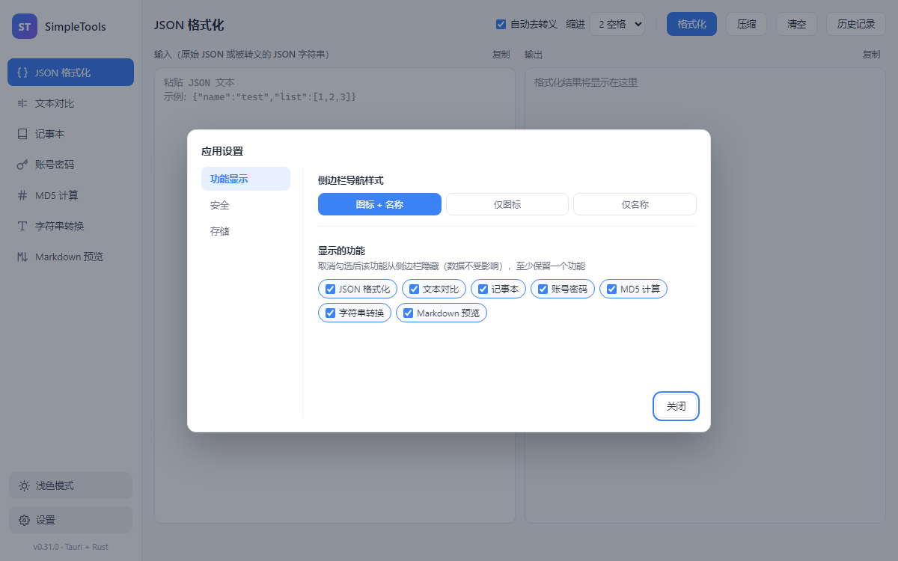

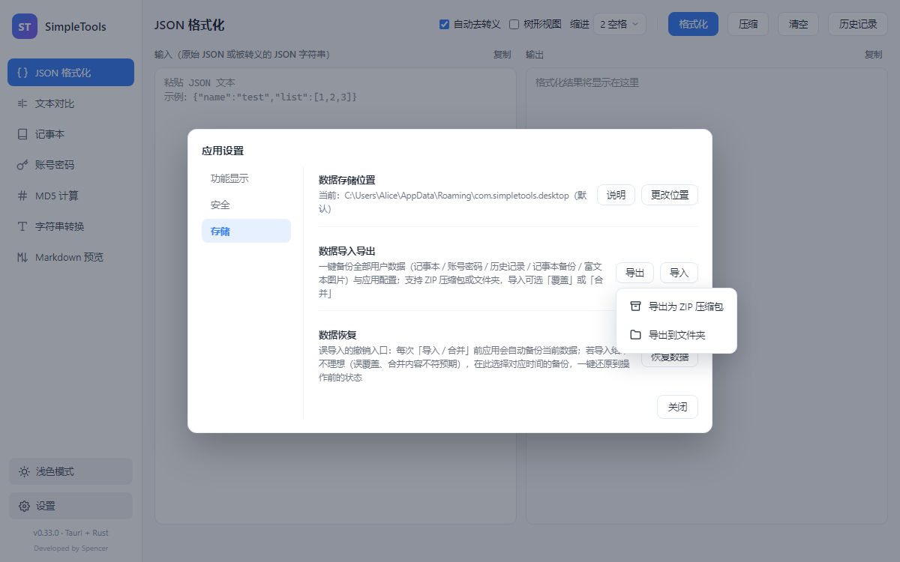

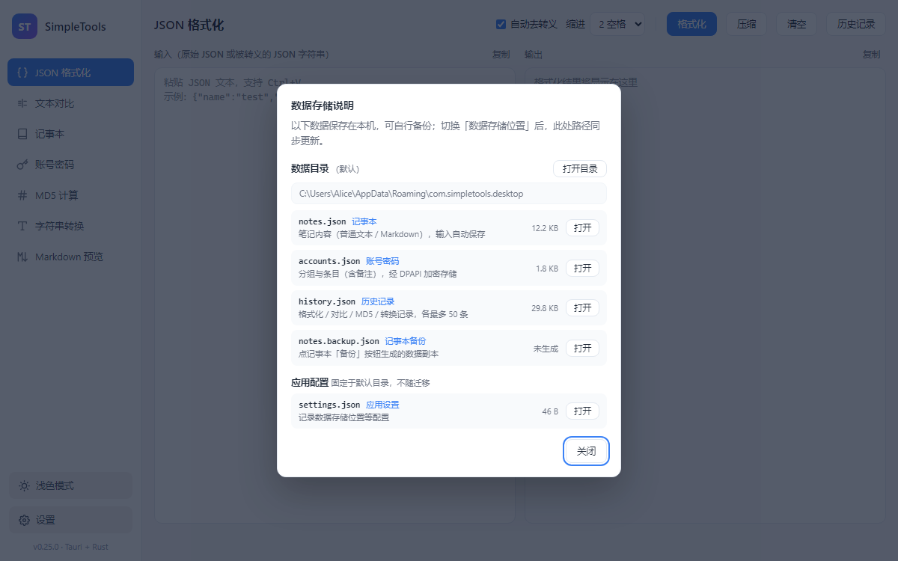

### MD5 计算（字符串 + 文件 + 历史记录）

字符串输入实时计算；文件可点击选择或直接从资源管理器拖入（大文件不占内存，拖入大文件时显示进度）；结果支持小写 hex / 大写 HEX / Base64 三种格式；文本 / 文件计算结果自动留存历史记录，点击记录可恢复输入与哈希（下图为历史记录下拉）。

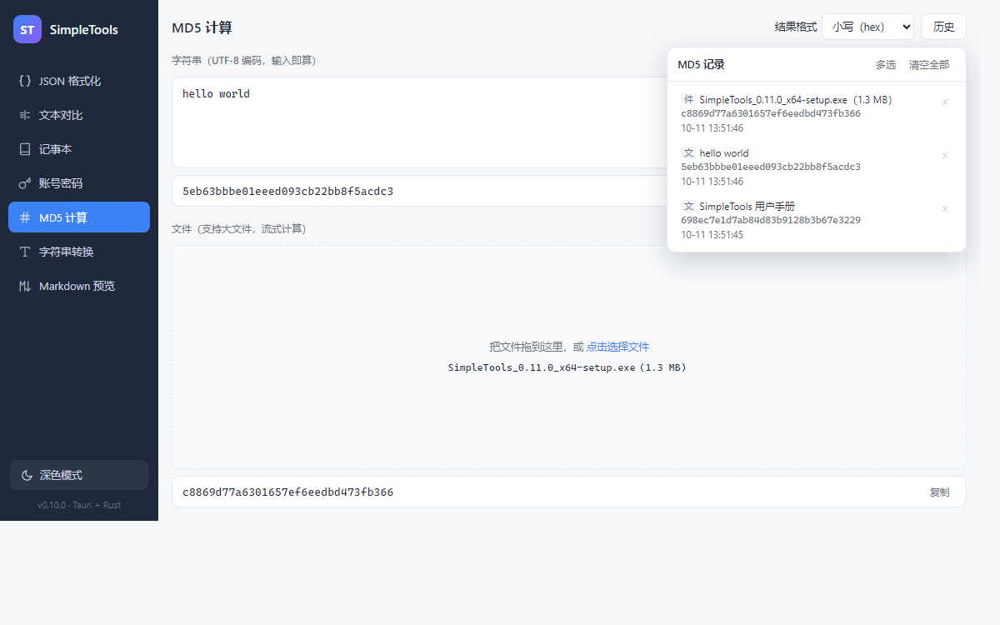

### 字符串转换（大小写 + 命名风格 + 历史记录）

输入一个字符串，自动生成全大写 / 全小写 / 首字母大写 / 驼峰 / 大驼峰 / 下划线 / 中划线 / 常量共 8 种结果，点击行尾即可复制；自动识别下划线、中划线、空格、点分隔及已有驼峰，多行输入按行转换；输入停止后自动留存历史记录，点击记录可恢复输入并重新转换（下图为历史记录下拉）。

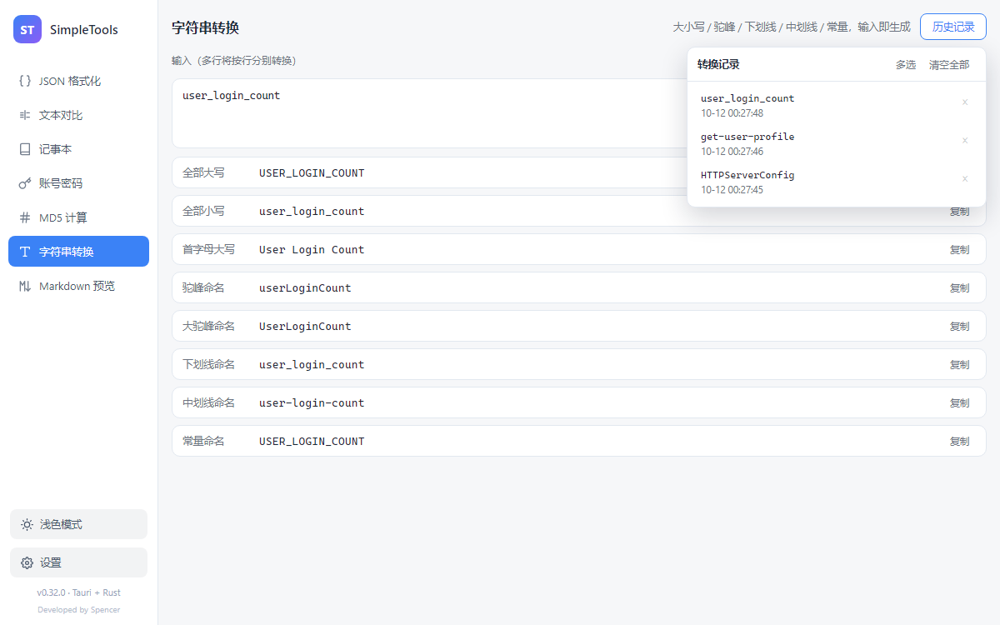

### Markdown 预览（渲染 + 目录 + 搜索联动 + 图片）

左侧输入或打开 `.md` 文件（支持直接拖入），右侧实时渲染预览（标题 / 表格 / 代码块 / 任务列表等常用语法，原始 HTML 自动转义防注入）；支持图片显示 —— 网络图片（http / https）直接加载，本地图片（绝对路径 / `file://` / 基于文档所在目录的相对路径）经 asset 协议加载，加载失败显示虚线占位；支持目录导航（点击跳转 + 滚动高亮）、全文搜索（高亮 / 计数 / 上下跳转，可勾选「同步源文件」联动左侧输入区同步滚动）、字号与阅读宽度调节（自动记忆）、阅读进度条，以及一键复制 Markdown 源码与渲染 HTML；支持保存为 `.md` 文件（已打开的文件直接覆盖，未命名弹出另存为）（下图为渲染效果 + 目录浮层）。

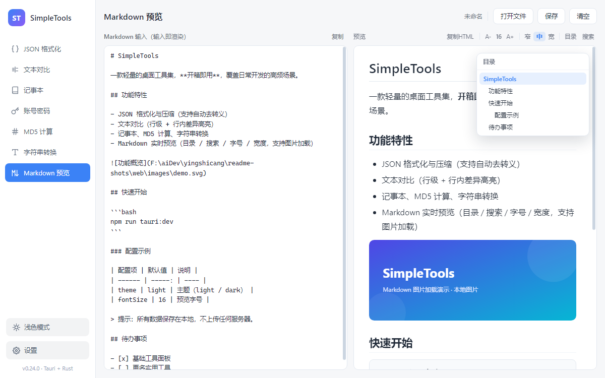

### 抓包（手机设置代理即可实时抓包，类似 Fiddler 的轻量替代）

内置 HTTP / HTTPS 中间人代理（MITM，默认端口 8888）：启动后手机与电脑连同一 Wi-Fi、在 Wi-Fi 设置里把代理指向电脑局域网 IP 与该端口，即可实时捕获手机上 App / 浏览器的全部请求 —— 请求 / 响应完整参数（方法、URL、状态码、耗时、大小、请求头 / 响应头 / 正文 —— gzip / deflate / brotli 自动解压、JSON 自动美化）、接口成功 / 失败一目了然（失败与 4xx / 5xx 红色标记，支持「全部 / 成功 / 失败」过滤与关键字搜索）；HTTPS 流量经动态签发的域名证书解密，需先「导出证书」并在手机上安装信任（面板内置设置指引与本机 IP 显示，可一键打开完整「使用教程」弹窗：电脑端启动 / 手机代理设置（Android / iPhone）/ 根证书安装与信任 / 验证方式 / 常见问题分步说明，教程内动态显示本机代理地址）；点列表任意一条查看详情（请求头 / 请求体 / 响应头 / 响应体四标签页，一键复制）；记录保存在内存（上限 2000 条、超出淘汰最早），可随时清空，停止抓包即时释放端口。

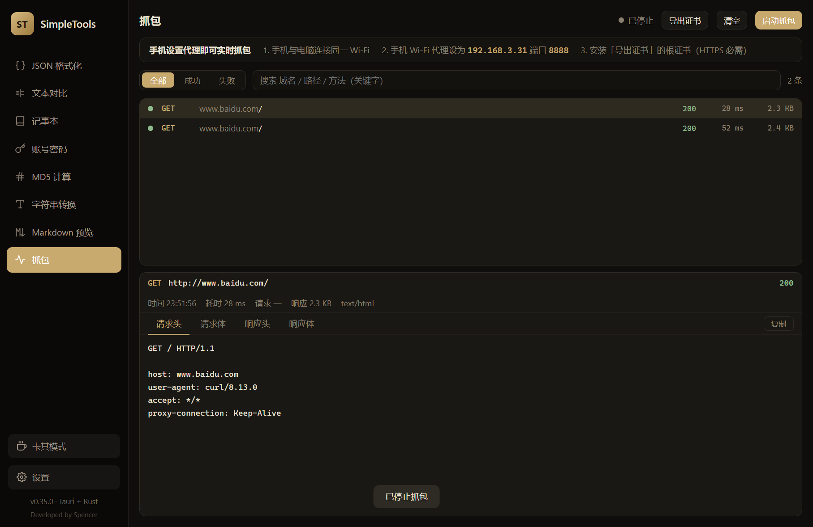

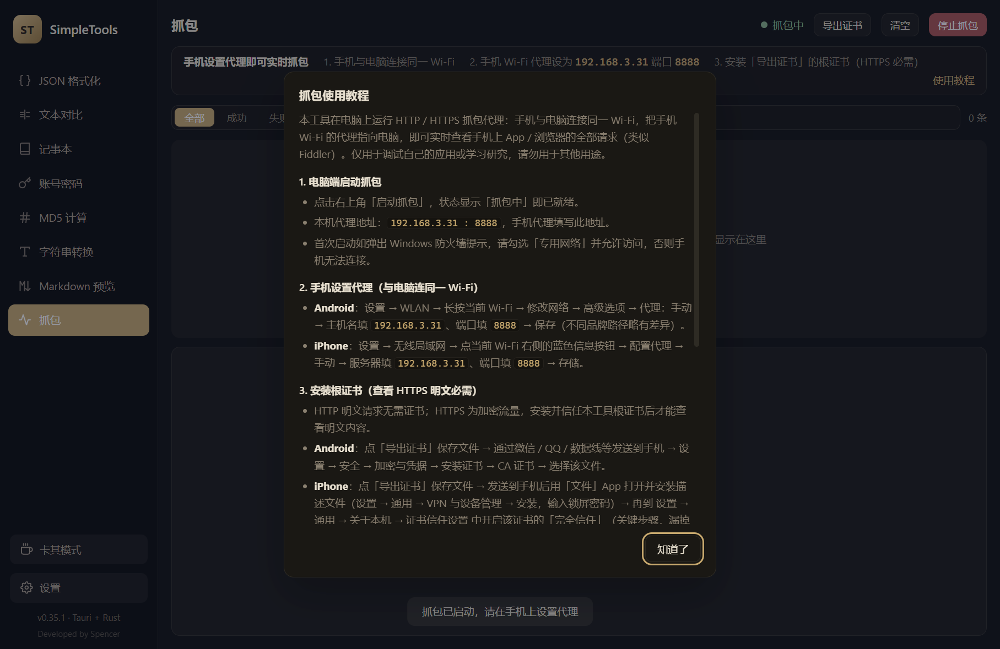

### 模拟服务器（本地起接口，抓取客户端请求的请求头与参数）

在电脑上启动一个 HTTP 模拟服务（默认端口 8899）：客户端（App / 浏览器 / 其他设备）把接口地址指向电脑后，请求会被完整记录并返回预先配置的响应 —— 接口灵活配置（点「添加接口」逐条添加：请求方法 ANY / GET / POST / PUT / DELETE / PATCH / HEAD、路径（精确匹配，`/api/*` 前缀通配）、响应状态码与响应体），配置持久保存、服务运行中增删即时生效；请求列表实时显示（时间 / 方法 / 路径 / 来源 IP / 状态码，命中绿色、未匹配 404 橙色标记），点击任意一条展开查看请求头与请求参数（Query 键值对列表，请求正文自动展示、JSON 自动美化，超 256KB 截断提示）；每条接口支持一键复制完整访问地址；同网段设备直接访问，跨网段 / 外网可配合内网穿透工具（frp / ngrok 等）转发本端口；响应统一带 CORS 头，浏览器页面可直接跨域请求；记录上限 500 条、可随时清空。

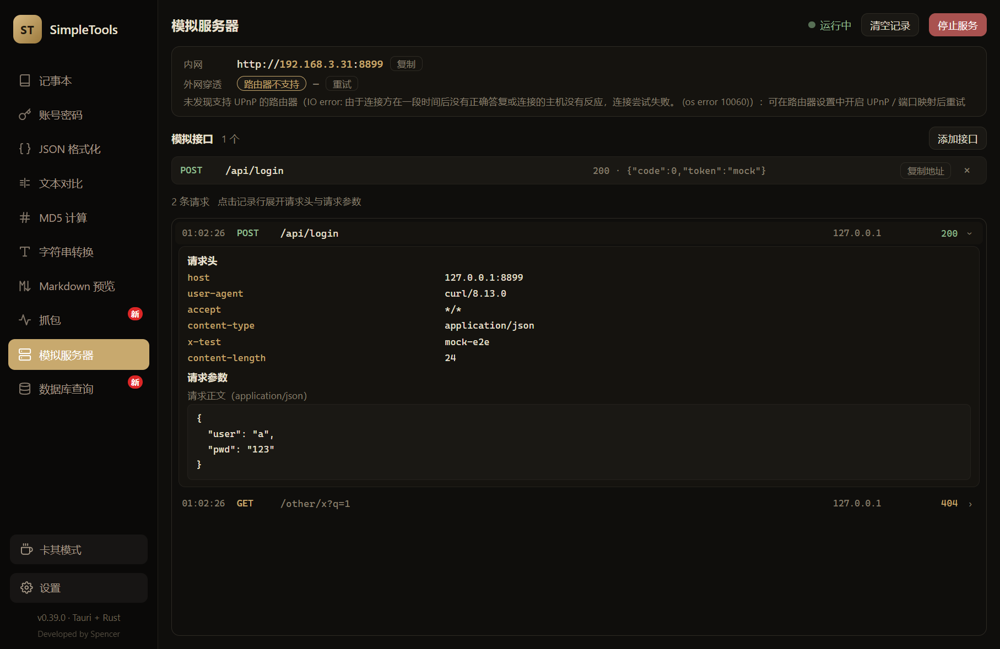

### 数据库查询（打开 SQLite 文件直接用 SQL 查询，输入智能提示）

打开本地 SQLite 数据库文件（.db / .sqlite / .sqlite3 / .db3），以只读方式执行 SQL 查询（不修改原文件，写操作给出只读提示）—— 左侧表结构栏列出全部表与视图，点表名展开列（列名 / 类型 / 主键 PK 标记，点击列名一键插入到编辑器）；SQL 编辑器输入时自动弹出友好建议提示（表名 / 字段名 / SQL 关键字三类彩色标识，前缀匹配优先，↑↓ 选择、Enter / Tab 补全、Esc 关闭，鼠标点选亦可）；查询结果以表格展示（行号列、NULL 灰色斜体、数字右对齐、表头吸附），显示行数与耗时，超 5000 行自动截断提示；打开非 SQLite 文件 / 加密库 / 语法错误等均有清晰提示。

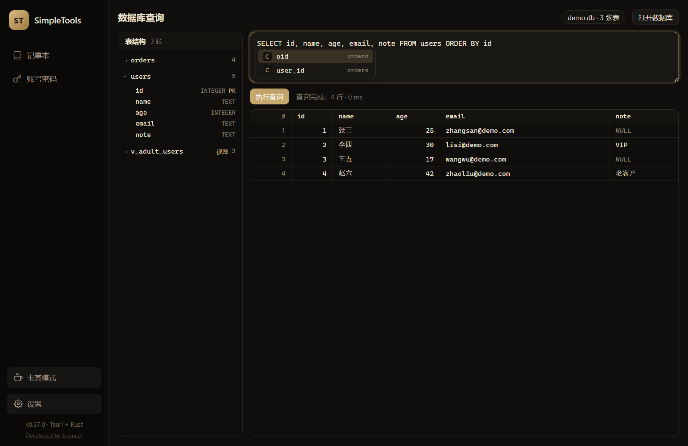

### 主题切换（浅色 / 深色 / 深浅混搭 / 卡其色）

侧边栏底部点击主题按钮弹出选择菜单，直接点选浅色 / 深色 / 深浅混搭 / 卡其色四种主题（当前主题高亮 + 对勾标识，按钮同步显示当前主题的图标与名称）；深浅混搭为浅色主体 + 深色功能菜单 —— 侧边栏与系统标题栏切为深蓝黑，内容区保持浅色对比鲜明；卡其色为暖色暗调（复刻在线 MD 阅读器配色：暖黑棕底色 + 卡其金强调色），选择自动记忆，切换带平滑过渡；窗口系统标题栏与侧边栏配色整体随主题联动 —— 标题栏颜色同步切换（Windows 11 22H2+ 生效），浅色主题下侧边栏为白色浅色样式；左上角应用品牌图标随主题适配 —— 卡其色主题下为卡其金渐变 + 暖棕文字，与暖色暗调界面协调；系统标题栏左上角的应用小图标同步随主题切换 —— 浅色 / 深色 / 深浅混搭为蓝紫渐变、卡其色为卡其金渐变（与侧边栏品牌图标同款，任务栏图标联动）。

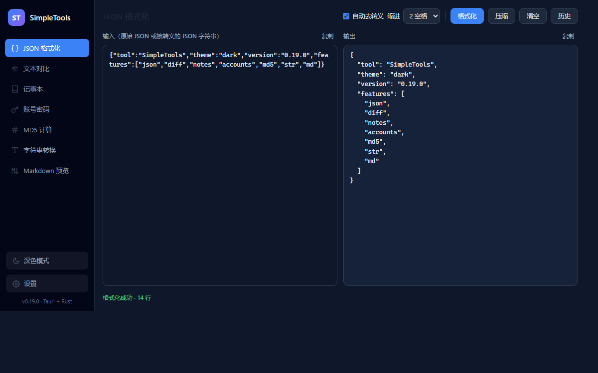
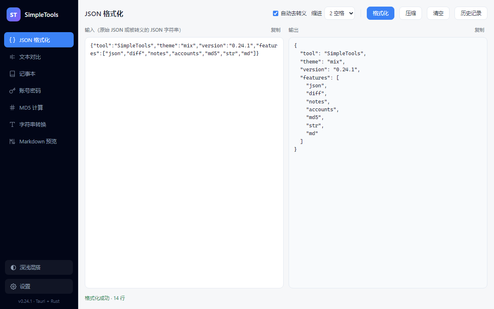
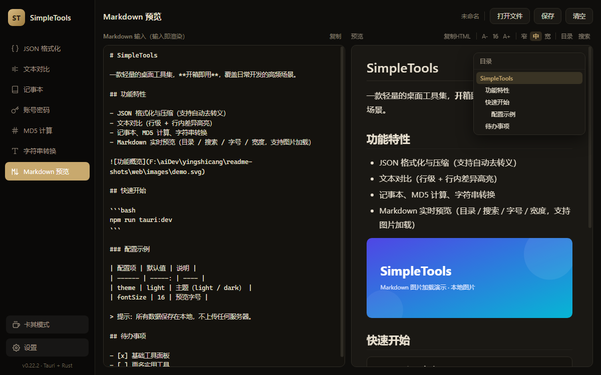

## 功能支持

- [x] **JSON 格式化** —— 格式化 / 压缩；自动去转义（默认开启、可选）；2 / 4 空格或 Tab 缩进；树形视图（可折叠树展示结果，可展开 / 折叠全部，过大自动退回文本）；输入输出一键复制；格式化 / 压缩历史记录（自动留存、点击恢复、单条删除、多选批量删除、一键清空）
- [x] **文本对比** —— 行级 + 字符级差异高亮（左侧绿、右侧红）；自动提取 JSON（从混杂文本提取 JSON 片段，兼容转义）与 JSON 树形结构对比（并排可折叠树，差异节点高亮）；左右文本与对比结果一键复制（结果含 `-` / `+` 差异标记）；对比历史记录（点击恢复左右文本并自动重新对比、多选批量删除）；忽略首尾空白选项；交换左右 / 清空
- [x] **记事本** —— 左列表右详情；标题 + 正文（列表标题最多两行展示）；普通笔记 / Markdown 笔记 / 任务笔记三种类型（新建时选择，列表图标区分；普通笔记为富文本编辑器——加粗 / 斜体 / 下划线 / 有序无序列表 / 插入本地图片，与富文本任务同款）；Markdown 笔记左编辑右实时预览（复用 Markdown 渲染器，预览区支持目录导航与关键字搜索：高亮 / 计数 / 上下跳转，可勾选「同步源文件」联动左侧源码同步滚动）；任务笔记（任务组 + 多条任务：完成 / 未完成勾选与「已完成 x / y」计数、自动递增序号（默认开启可取消）、简单任务（纯文本，点击行内编辑、编辑框随内容多行自适应）与富文本任务（必填标题 + 所见即所得内容：加粗 / 斜体 / 下划线 / 有序无序列表 / 插入本地图片 asset 协议显示，粘贴自动转纯文本））；本地缓存自动保存（原子写入防损坏）；列表拖动排序（任务笔记内任务亦可拖动排序：整行拖动、上下插入位置提示）；双模式搜索（默认「标题」按记录标题实时过滤、点双向箭头图标切换「内容」按正文模糊匹配，大小写不敏感；任务笔记按任务级匹配：简单任务文本 / 富文本标题与内容，内容命中显示标题 + 「内容匹配」标记、点击进详情高亮命中词；命中片段高亮，内容模式展示正文命中摘要行，过滤中修改自动同步，清空恢复）；删除弹窗确认；批量操作（多选 / 全选 / 批量删除 / 批量导出）；导出为 JSON / TXT（单条 / 批量，自选目标文件夹，任务笔记含序号与勾选状态）；复制正文；数据备份
- [x] **账号密码** —— 分组（标题）管理：组名直接编辑、分组与条目支持拖动排序（分组整行拖动、条目经行首手柄拖动）、组内条目行内新增 / 删除 / 修改（含备注，可选填、高度随内容自适应），本地自动保存（Windows DPAPI 加密存储，与当前电脑用户绑定）；单独复制账号 / 复制密码、一键复制（账号 + 密码，均为图标按钮 + 悬停提示）；密码默认遮蔽 + 一键显示 / 隐藏；按分组名 / 账号 / 备注关键字三条件模糊搜索（跨分组匹配、结果显示所属分组名，命中同一目标自动合并为一条，分组名、账号、备注中的命中片段高亮标亮，结果可直接复制）；删除分组 / 条目弹窗确认；批量导出（当前分组 / 全部账号 × TXT / 表格 CSV，含备注，自选文件夹）
- [x] **应用设置** —— 「功能显示」：侧边栏导航样式三选一（图标 + 名称 / 仅图标（缩窄 64px + 悬停提示）/ 仅名称）与功能显隐勾选（取消即隐藏、至少保留一个、隐藏当前功能自动切换、即时生效并记忆）；安全选项「查看账号密码需 Windows Hello 验证」：开启后进入「账号密码」需先通过 PIN / 指纹 / 面容等 Windows Hello 方式验证（系统弹窗接管），开关开启 / 关闭同样需要验证、取消或失败自动回滚；未配置 Windows Hello 时给出提示引导；「数据存储位置」显示当前数据目录（默认 / 自定义），支持更改位置 —— 记事本 / 账号密码 / 历史记录自动迁移至新位置（原位置文件保留）、迁移后自动重载、失败给出提示，支持一键恢复默认；「数据存储说明」弹窗动态列出各数据文件（记事本 / 账号密码 / 历史记录 / 备份 / 应用配置）的当前位置与大小，每行可一键在资源管理器中打开定位，跟随存储位置切换实时更新；「数据导入导出」一键备份全部用户数据与应用配置 —— 导出为 ZIP 压缩包（自选位置与文件名）或文件夹（自动创建带时间戳备份目录），导入支持 ZIP / 文件夹并可选「覆盖导入」或「合并导入」（合并规则：笔记重名自动改名、同名分组归一、账号按账号去重、历史按内容去重；确认弹窗含说明、本次统计、备份完整路径与风险提示；执行前自动备份到 `import-backup-时间戳` 文件夹，完成后自动重载）；「数据恢复」列出每次导入 / 合并前的自动备份，选择后一键还原到操作前状态；旧版本备份 / 数据文件完全兼容（缺失字段按默认值解析并自动补全 ID）
- [x] **MD5 计算** —— 字符串实时计算（UTF-8）；文件点击选择或直接拖入计算（大文件不占内存，拖入大文件时显示进度）；小写 / 大写 / Base64 三种输出格式；一键复制；文本 / 文件计算历史记录（自动留存、点击恢复、单条删除、多选批量删除、一键清空）
- [x] **字符串转换** —— 输入即生成 8 种格式：全大写 / 全小写 / 首字母大写 / 驼峰（camelCase）/ 大驼峰（PascalCase）/ 下划线（snake_case）/ 中划线（kebab-case）/ 常量（CONSTANT_CASE）；自动识别下划线、中划线、空格、点分隔与已有驼峰；多行按行转换；逐行一键复制；输入历史记录（停止输入后自动留存、点击恢复、多选批量删除）
- [x] **Markdown 预览** —— 输入 / 粘贴即实时渲染（GFM 常用语法：标题、粗体斜体、行内代码、围栏代码块、列表与嵌套、任务列表、表格、引用、分割线、链接、图片、裸 URL 自动链接）；图片显示（网络图片与 `data:image` 直载；本地图片经 asset 协议加载，支持绝对路径 / `file://` / 基于文档目录的相对路径与 `./` `../` 解析；加载失败或危险协议显示占位）；打开或拖入 `.md` 文件；目录导航（点击跳转、滚动高亮）；全文搜索（高亮、计数、上下跳转，可勾选「同步源文件」联动左侧输入区同步滚动）；字号 13–20 与阅读宽度（窄 / 中 / 宽）调节并记忆；阅读进度条；复制源码 / 渲染 HTML；保存为 `.md` 文件（已打开文件直接覆写、未命名另存为对话框）；原始 HTML 自动转义、危险链接协议过滤
- [x] **抓包** —— 内置 HTTP / HTTPS MITM 代理（端口 8888）：手机设代理即可实时捕获请求 / 响应（方法 / URL / 状态码 / 耗时 / 大小 / Content-Type 一览）；接口成功与失败直观标记（网络失败 + 4xx / 5xx 红色）；请求头 / 响应头 / 请求体 / 响应体四标签页详情（正文 gzip / deflate / brotli 自动解压、JSON 自动美化、超限截断提示、二进制标记，一键复制）；「全部 / 成功 / 失败」过滤 + 关键字搜索；HTTPS 解密（根证书一键导出，面板内置设置指引与本机 IP 显示）；启动 / 停止即时生效、端口占用等错误提示清晰；记录上限 2000 条（内存）、一键清空
- [x] **模拟服务器** —— 本地 HTTP 接口模拟（端口 8899）：接口灵活配置（方法 ANY / GET / POST / PUT / DELETE / PATCH / HEAD + 路径（精确匹配 / `*` 前缀通配）+ 响应状态码与响应体，点「添加接口」即可，配置持久保存、运行中增删即时生效）；客户端请求实时记录（时间 / 方法 / 路径 / 来源 IP / 状态码，命中 / 未匹配（404）着色区分），点击记录展开请求头与请求参数（Query 键值对 + 请求正文，JSON 自动美化、超限截断提示）；一键复制接口完整地址；跨网段 / 内网穿透兼容（监听全部网卡，配合 frp / ngrok 转发即可外网访问）；CORS 响应头统一附带；记录上限 500 条、一键清空
- [x] **数据库查询** —— 打开本地 SQLite 数据库文件（.db / .sqlite / .sqlite3 / .db3）只读查询：表结构侧栏（表 / 视图 + 展开列名 / 类型 / 主键，点列名插入编辑器）；SQL 编辑器智能提示（表名 / 字段名 / SQL 关键字三类候选，前缀匹配优先，↑↓ 选择 / Enter・Tab 补全 / Esc 关闭 / 点选应用）；查询结果表格（行号列、NULL 灰色斜体、数字右对齐、表头吸附滚动，行数与耗时统计，超 5000 行截断提示）；只读保护（写操作给出只读提示，不修改原文件）；非 SQLite 文件 / 加密库 / 语法错误清晰提示
- [x] **界面主题** —— 默认简约浅色；点击主题按钮弹出菜单直接选择浅色 / 深色 / 深浅混搭 / 卡其色并记忆（当前项高亮 + 对勾，按钮显示当前主题图标与名称；深浅混搭为浅色主体 + 深色功能菜单，侧边栏与标题栏深蓝黑、内容区保持浅色；卡其色为暖色暗调，复刻在线 MD 阅读器配色）；切换平滑过渡；窗口系统标题栏颜色随主题同步（Windows 11 22H2+）；浅色主题下侧边栏为浅色样式，图标 / 文字 / 按钮配色整体适配；应用品牌图标随主题换色（卡其色为主题色卡其金渐变 + 暖棕文字）；系统标题栏左上角小图标随主题切换（浅色 / 深色 / 深浅混搭蓝紫渐变、卡其色卡其金渐变，与品牌图标同款，任务栏联动）
- [x] **全局体验** —— 无边框简约布局、Toast 轻提示、剪贴板复制三级降级（Tauri 插件 → 浏览器 API → 兜底方案）

> 后续新增功能会持续更新本 README 的功能清单与效果截图（见文末[更新日志](#更新日志)）。

## 构建与运行

```powershell
# 安装前端工具链（仅首次）
npm install

# 开发模式（热重载）
npm run dev

# 构建发布版（免安装 exe + NSIS 安装包）
npm run build
```

构建产物：

- 安装包：`src-tauri/target/release/bundle/nsis/SimpleTools_0.37.0_x64-setup.exe`
- 免安装单文件：`src-tauri/target/release/SimpleTools.exe`

> 首次构建约需几分钟（Rust 编译）；前端为静态资源，修改 `src/` 后需重新执行 `npm run build` 才生效。

## 技术栈

| 层 | 说明 |
| --- | --- |
| 后端 | Rust + Tauri 2（`src-tauri/`） |
| 剪贴板 | 官方 `tauri-plugin-clipboard-manager`（前端带三级降级兜底） |
| 文件选择 | 官方 `tauri-plugin-dialog` |
| MD5 | `md-5` crate（点击选择流式读取、1 MB 分块；拖入文件由前端按 8 MB 分块计算） |
| 安全能力 | Windows DPAPI 加密（`crypt32`）+ Windows Hello 身份校验（`UserConsentVerifier` WinRT API），直接调用系统能力（`src-tauri/src/winsec.rs`） |
| Markdown 渲染 | 自研轻量解析器（前端，无第三方依赖；原始 HTML 转义防注入；预览面板与记事本 Markdown 笔记共用） |
| 前端 | 原生 HTML / CSS / JavaScript（`src/`，无框架、无打包） |
| 数据存储 | 默认 `%APPDATA%\com.simpletools.desktop\`，可在「应用设置 → 数据存储位置」中更改并自动迁移：`notes.json`（记事本）、`accounts.json`（账号密码，DPAPI 加密存储）、`history.json`（历史记录）、`notes.backup.json`（记事本备份）、`images/`（富文本图片，笔记以相对路径引用），数据文件均原子写入；应用配置 `settings.json` 固定存放于默认目录（不随迁移）；「应用设置 → 说明」可查看各文件位置并直接打开 |
| 数据备份 | `zip` crate（数据导入导出：ZIP 打包 / 解包，白名单文件校验 + 防路径穿越，富文本图片一并打包；导入前自动备份至 `import-backup_时间戳`，`src-tauri/src/backup.rs`） |

## 开发环境

> 仅开发者需要；普通用户下载安装包即可使用。

| 组件 | 位置 / 版本 |
| --- | --- |
| Rust 工具链 | `F:\Rust\rustup`（RUSTUP_HOME）、`F:\Rust\cargo`（CARGO_HOME），rustc 1.99.0 |
| crates 镜像 | `F:\Rust\cargo\config.toml` → rsproxy 国内镜像 |
| VS Build Tools 2022 | `F:\VS\BuildTools`（MSVC v14.44 + Windows 11 SDK 22621） |
| Windows SDK | `F:\Windows Kits\10` |
| Node.js | v24（用于 tauri-cli 与前端脚本） |

## 目录结构

```
SimpleTools/
├── screenshots/          # README 效果截图
├── src/                  # 前端（静态资源，直接作为 frontendDist）
│   ├── index.html
│   ├── styles.css
│   ├── main.js           # 导航 & Toast & 主题切换 & 应用设置 & 复制 / 弹窗组件
│   └── modules/
│       ├── history.js      # 历史记录（格式化 / 对比 / MD5 / 转换，与面板绑定）
│       ├── json-format.js  # JSON 格式化（含树形视图开关）
│       ├── json-tree.js    # JSON 树形视图（折叠树渲染 / 片段提取 / 结构差异标记，格式化与对比共用）
│       ├── text-diff.js    # 文本对比（LCS diff + 自动提取 JSON + 树形结构对比）
│       ├── drag-sort.js    # 拖拽排序（空位跟随模型，记事本任务与账号密码共用）
│       ├── notes.js        # 记事本（三种类型 / 任务笔记 / 拖动排序 / 自动保存 / 导出 / 搜索高亮）
│       ├── accounts.js     # 账号密码（分组管理 + 复制 + 搜索过滤 + 批量导出）
│       ├── md5.js          # MD5 计算（字符串 + 文件）
│       ├── str.js          # 字符串转换（大小写 + 命名风格）
│       └── markdown.js     # Markdown 预览（自研解析器 + 目录 / 搜索 / 字号）
├── src-tauri/            # Rust 后端
│   ├── Cargo.toml
│   ├── tauri.conf.json
│   ├── capabilities/
│   ├── icons/
│   └── src/
│       ├── main.rs
│       ├── lib.rs
│       ├── datadir.rs    # 数据目录解析与迁移命令（data_dir_info / data_dir_set / storage_info / open_in_explorer）
│       ├── backup.rs     # 数据导入导出命令（data_export / data_import，ZIP / 文件夹）
│       ├── notes.rs      # 记事本存储命令（load/save/backup/export，含笔记类型字段）
│       ├── accounts.rs   # 账号密码存储命令（load/save/export）
│       ├── history.rs    # 历史记录存储命令（load/save）
│       ├── md5calc.rs    # MD5 命令（含单元测试）
│       ├── textfile.rs   # 文本文件读写命令（Markdown 预览打开 / 保存文件）
│       ├── titlebar.rs   # 系统标题栏颜色与窗口图标命令（随应用主题同步，Windows 11）
│       └── winsec.rs     # Windows Hello 身份校验（UserConsentVerifier）+ DPAPI 加密（账号密码数据）
└── scripts/
    └── gen-icon.ps1      # 重新生成应用图标
```

## 更新日志

### v0.37.0（2026-10-13）

- 新增「数据库查询」功能：打开本地 SQLite 数据库文件（.db / .sqlite / .sqlite3 / .db3）以只读方式执行 SQL 查询（内置 SQLite，无外部依赖）—— 表结构侧栏列出全部表与视图，点表名展开列（列名 / 类型 / 主键标记，点击列名一键插入编辑器）
- SQL 输入智能提示：输入时自动弹出友好建议（表名 / 字段名 / SQL 关键字三类彩色标识，前缀匹配优先排序），↑↓ 选择、Enter / Tab 补全、Esc 关闭、鼠标点选均可；关键字补全后自动补空格
- 查询结果：表格展示（行号列、NULL 灰色斜体、数字右对齐、表头吸附滚动），显示返回行数与查询耗时，超 5000 行自动截断并提示；错误提示友好化（只读写操作 / 表或字段不存在 / 语法错误分别说明）
- 安全与兼容：只读打开不修改原文件（主动校验 SQLite 文件头，非数据库 / 加密库明确提示）；新功能项自动出现在「应用设置 → 功能显示」（默认隐藏，勾选后显示）

### v0.36.0（2026-10-13）

- 新增「模拟服务器」功能：本地起 HTTP 接口模拟服务（默认端口 8899）—— 接口灵活配置（方法（ANY / GET / POST / PUT / DELETE / PATCH / HEAD）+ 路径（精确匹配，`/api/*` 前缀通配）+ 响应状态码与响应体），点「添加接口」逐条添加、配置持久保存（数据目录 `mock-rules.json`）、服务运行中增删即时生效
- 请求实时记录并返回配置响应：列表显示时间 / 方法 / 路径 / 来源 IP / 状态码（命中绿色、未匹配 404 橙色），点击任意一条展开请求头与请求参数（Query 键值对列表 + 请求正文「JSON 自动美化」，超 256KB 截断提示）；未匹配路径的请求同样记录并返回 404，方便发现客户端实际调用的接口
- 网络与兼容：监听全部网卡（同网段直接访问），跨网段 / 外网可配合内网穿透工具转发本端口；响应统一附带 CORS 头（含 OPTIONS 预检），浏览器页面可直接跨域请求；每条接口一键复制完整访问地址
- 稳定性：记录保存在内存（上限 500 条，超出淘汰最早），规则校验（方法白名单 / 路径补斜杠 / 状态码 100-599 / 响应体 1MB 上限）错误即时提示；新功能项自动出现在「应用设置 → 功能显示」（默认隐藏，勾选后显示）

### v0.35.2（2026-10-13）

- 默认功能显示调整：侧边栏默认仅显示「记事本」与「账号密码」两个主要功能，默认打开记事本；其余功能（JSON 格式化 / 文本对比 / MD5 计算 / 字符串转换 / Markdown 预览 / 抓包）默认隐藏，可在「应用设置 → 功能显示」中勾选恢复
- 启动体验：新增首帧引导样式避免默认隐藏过程的功能闪动；启动时若用户配置隐藏了默认激活面板，自动切换到第一个可见功能；「全部勾选」时与未配置状态区分（全部显示偏好被正确记忆）

### v0.35.1（2026-10-12）

- 抓包面板新增完整「使用教程」弹窗：分步说明电脑端启动、手机代理设置（Android / iPhone 分别给出操作路径）、根证书安装与信任（含 iPhone「证书信任设置」完全信任关键步骤）、验证方式与常见问题；教程内动态显示本机代理地址，指引条右侧一键打开

### v0.35.0（2026-10-12）

- 新增「抓包」功能：内置 HTTP / HTTPS 中间人代理（MITM）—— 手机与电脑连同一 Wi-Fi 并将 Wi-Fi 代理设置为面板指引中显示的本机 IP + 端口（默认 8888）后，手机上 App / 浏览器的请求实时显示在列表（方法 / 域名路径 / 状态码 / 耗时 / 大小），类似 Fiddler 的核心体验
- 接口抓取：请求与响应完整参数（请求头 / 响应头 / 请求体 / 响应体四标签页详情，一键复制）；网络失败与 4xx / 5xx 红色标记，「全部 / 成功 / 失败」过滤 + 关键字搜索快速定位接口；正文自动解压（gzip / deflate / brotli）与 JSON 美化，超 256 KB 截断提示，大文件 / 流式响应自动跳过并标注
- HTTPS 解密：动态签发域名证书的中间人解密（导出根证书 → 手机安装信任即可查看 HTTPS 明文）；根证书首次启动自动生成并持久保存于数据目录，已安装的证书长期有效
- 稳定性细节：记录保存在内存（上限 2000 条，超出淘汰最早），应用重启自动清空；停止抓包即时释放端口；端口被占用等启动错误直接提示原因；新功能项自动出现在「应用设置 → 功能显示」

### v0.34.0（2026-10-12）

- 记事本「普通文本」更名「普通笔记」并升级为所见即所得富文本编辑器：与富文本任务同款编辑体验（加粗 / 斜体 / 下划线 / 有序与无序列表 / 插入本地图片），插入的本地图片同样自动收纳到数据目录 `images/` 并随数据迁移与一键备份；旧版纯文本笔记首次打开时自动转换（换行保留、特殊字符转义），无缝升级
- 记事本搜索范围切换按钮加入双向箭头图标：直观提示「标题 / 内容」两种模式可点击切换，图标随当前模式高亮

### v0.33.0（2026-10-12）

- JSON 格式化新增「树形视图」：格式化 / 压缩结果可切换为可折叠树形展示（点行或箭头展开收起，提供「展开全部 / 折叠全部」按钮；JSON 过大自动跳过并退回文本显示），恢复历史记录时树形视图同步刷新
- 文本对比新增「自动提取 JSON」与「JSON 树形结构」对比：可从两侧文本中自动提取 JSON 片段（支持被转义的日志 / 代码内容）参与对比；勾选「JSON 树形结构」后两侧 JSON 以并排可折叠树展示，差异节点高亮（绿色 = 左侧独有 / 旧值，红色 = 右侧独有 / 新值），JSON 过大自动退回文本对比
- 拖拽排序升级为「空位跟随」模型：记事本任务与账号密码分组 / 条目拖动时，源行变为蓝色虚线空位并随拖拽位置实时移动、带平滑过渡无闪动；账号条目经行首手柄拖动、任务整行拖动，行为与提示更直观
- 文件拖入改用 HTML5 拖放（页内拖拽排序的前提）：MD5 与 Markdown 面板拖入文件按内容读取 —— MD5 拖入大文件按 8 MB 分块计算（不占内存、显示进度百分比），Markdown 拖入文件超过 20 MB 时提示改用「打开」按钮；同时全局拦截含文件的默认拖放，避免 WebView 误打开文件
- 富文本任务图片数据自包含：插入的本地图片自动复制到数据目录 `images/` 文件夹并以相对路径引用，数据存储位置迁移、一键备份导出 / 导入、「数据恢复」均自动带上图片；合并导入时图片同名同内容跳过、同名不同内容自动改名并同步更新笔记中的引用（`images/` 总大小与数量在导入 / 导出 / 恢复提示中展示）
- 应用设置「功能显示」升级为卡片网格：功能项以两列网格展示（功能图标 + 名称 + 右侧选中圆标），最后一项通栏；弹窗高度保持稳定不跳动
- 侧边栏版本号下方新增开发者署名；修复隐藏面板（如账号密码备注高度）在首次显示时布局测量不准的问题

### v0.32.0（2026-10-11）

- 「导入」新增「合并导入」模式：选完备份后先选导入方式 —— 「覆盖导入」（整文件替换，与旧版一致）或「合并导入」（保留当前数据合并进来：笔记重名自动改名为「名称-1」、同名分组自动归一、账号记录按账号去重、历史记录按内容去重），确认弹窗展示本次合并统计（新增条数 / 自动改名数）
- 新增「数据恢复」独立入口：设置「存储」分类新增一行，弹窗列出每次「导入 / 合并」前自动生成的备份（时间 / 文件夹名 / 文件数 / 大小），点「恢复」一键还原到操作前的状态（恢复本身即回退操作，不再生成新备份）
- 导入确认弹窗全面增强：覆盖导入给出备份提示（本次自动备份的完整真实路径）与「如何恢复旧数据」操作指引；合并导入给出合并说明、本次合并统计、备份提示与风险提示（合并后新旧数据合为一体、无法自动拆分）
- 旧版本数据完全兼容：读取 / 导入早期版本备份或数据文件（缺少 id / updated_at 等字段）不再解析失败 —— 缺字段按默认值解析并自动补全（缺失 ID 自动生成），笔记 / 账号密码 / 历史记录全兼容
- JSON「缩进」与 MD5「结果格式」由原生下拉框升级为自定义下拉菜单：与应用整体风格统一、选项间距更舒适（原生弹层无法调整间距）
- 记事本：任务笔记中的任务支持拖动排序（整行拖动、上下插入位置提示，按钮 / 勾选框上拖动不触发）；简单任务行内编辑框升级为多行自适应（长任务文本完整可见）；列表标题最多两行展示
- 账号密码：分组与条目支持拖动排序（分组整行拖动、条目经行首手柄拖动）；「复制账号 / 复制密码 / 一键复制」改为精致图标按钮（悬停提示）；备注框高度随内容自适应（全量展示、无内部滚动）
- 数据导入 / 导出菜单项增加图标与说明文字；修复设置弹窗打开时数据导入 / 导出菜单点击弹窗空白处不关闭的问题

### v0.31.0（2026-10-11）

- 「应用设置」弹窗全新横版左右布局：弹窗宽度由 410px 加宽至 700px，左侧新增分类导航（功能显示 / 安全 / 存储），右侧内容区按所选分类切换显示，浏览更清晰
- 三个分类面板等高布局，切换分类时弹窗高度保持一致不跳动；每次打开弹窗默认回到「功能显示」分类

### v0.30.1（2026-10-11）

- 「数据导入导出」菜单（应用设置内点「导出 / 导入」弹出）上下间距优化：菜单项上下内边距由 8px 增至 10px、容器内边距由 4px 增至 6px，选项之间增加 2px 间隙，缓解拥挤感

### v0.30.0（2026-10-11）

- 应用设置新增「数据导入导出」：一键备份 / 恢复全部用户数据与应用配置 ——「导出」支持保存为 ZIP 压缩包（保存对话框自选文件名与位置）或导出到文件夹（自动创建 `SimpleTools_backup_时间戳` 子文件夹）；「导入」支持从 ZIP 压缩包或文件夹恢复
- 导入安全机制：覆盖前自动把当前数据备份到数据目录下的 `import-backup_时间戳` 文件夹（导入出错可手动找回）；确认弹窗说明同名覆盖规则与账号密码跨用户限制
- 备份内容为全部数据文件（记事本 / 账号密码 / 历史记录 / 记事本备份）与应用配置 `settings.json`；换机导入时若备份中的自定义数据目录不存在，自动回退默认目录

### v0.29.0（2026-10-11）

- 窗口系统标题栏左上角的应用小图标随主题切换：浅色 / 深色 / 深浅混搭为蓝紫渐变「ST」、卡其色为卡其金渐变「ST」，与侧边栏品牌图标同款；图标经 Rust 命令动态替换（任务栏 / Alt+Tab 图标联动），无需重启即时生效

### v0.28.0（2026-10-11）

- 记事本新增「任务笔记」类型：一条记录即一个任务组，可添加多条任务 —— 「简单任务」（纯文本，点击文本行内编辑）与「富文本任务」（必填标题 + 所见即所得富文本内容：加粗 / 斜体 / 下划线 / 有序与无序列表 / 插入本地图片，图片经 asset 协议加载显示）；顶部「+ 简单任务」「+ 富文本任务」两个按钮添加
- 任务支持完成状态勾选（已勾选显示删除线并随数据保存），顶部实时显示「已完成 x / y」计数；「自动序号」默认开启 —— 任务前显示自动递增序号（1. 2. 3. …），可随时取消（状态随数据保存）
- 任务列表展示：简单任务显示文本、富文本任务显示标题（必填，留空显示「未命名任务」并带「富文本」徽标，点击进入详情编辑）；删除任务弹窗确认
- 记事本内容搜索支持任务级匹配：简单任务匹配任务文本、富文本任务匹配标题与内容；富文本内容命中时列表显示「标题 + 内容匹配」标记，点击进入详情并高亮命中字符串（高亮不写入数据）
- 导出 JSON / TXT 同步包含任务数据（序号与勾选状态、富文本 HTML 内容）；旧数据自动兼容（无任务字段按空处理）

### v0.27.0（2026-10-11）

- 移除应用内全部键盘快捷键操作：`Ctrl+Enter` 格式化 / 对比、`Ctrl+Shift+Enter` 压缩、`Ctrl+S` 保存 `.md`、搜索框 `Enter` 上下切换、`Esc` 关闭弹窗 / 历史浮层 / 清空搜索等全部失效，所有操作统一改为按钮点击（按钮功能不受影响）
- 同步清理按钮上的快捷键提示文案（格式化 / 压缩 / 对比 / 保存）与 JSON 输入框占位提示中的「支持 Ctrl+V」字样

### v0.26.0（2026-10-11）

- 应用设置新增「功能显示」区块：「侧边栏导航样式」支持「图标 + 名称」（默认）/「仅图标」/「仅名称」三种模式 —— 仅图标时侧边栏缩窄为 64px，导航按钮悬停显示功能名
- 「显示的功能」支持取消勾选暂时用不到的功能，立即从侧边栏隐藏（数据与配置保留、勾选即恢复），至少保留一个功能；正在使用的功能被隐藏时自动切换到第一个可见功能；配置即时生效并自动记忆（启动时无闪烁恢复）

### v0.25.0（2026-10-11）

- 记事本「Markdown 笔记」预览区新增目录与全文搜索（移植自 Markdown 预览面板）：预览区顶部工具条提供「目录 / 搜索」入口，目录浮层点击跳转 + 滚动高亮；关键字搜索高亮 / 计数 / 上下切换（`Enter` 下一个、`Shift+Enter` 上一个、`Esc` 关闭）
- 新增「同步源文件」勾选框：Markdown 预览面板与笔记预览区均支持，勾选（默认开启、选择记忆）后搜索命中上下切换时左侧源文件同步滚动到对应位置，源码与预览一起跳转；取消勾选仅移动预览

### v0.24.1（2026-10-11）

- 各面板顶部操作区选项间距优化（JSON 格式化 / 文本对比 / MD5 计算等）：选项与按钮之间间距由 8px 增大至 12px，选项换行时上下行距同步加大；面板标题与操作区间距微调，缓解选项拥挤感

### v0.24.0（2026-10-11）

- 记事本搜索升级为「标题 / 内容」双模式：搜索框左侧新增模式切换按钮（默认「标题」，点击切换「内容」），「标题」按记录标题实时过滤、「内容」按正文模糊匹配（大小写不敏感），输入框占位符随模式同步提示；两种范围配合覆盖标题与内容查找
- 搜索命中高亮：标题中匹配的关键字实时标亮；「内容」模式下命中记录在列表中展示正文命中处的摘要行（上下文截取、空白折叠、超出省略），摘要中关键字同样标亮，便于快速定位

### v0.23.0（2026-10-11）

- 应用设置新增「数据存储说明」：数据存储位置行增加「说明」按钮，弹窗列出各数据文件（记事本 / 账号密码 / 历史记录 / 记事本备份 / 应用配置）的用途、当前存放位置与实际大小（未生成的文件标注「未生成」）；应用配置固定于默认目录并特别标注；路径由后端实时解析，切换数据存储位置后同步更新（不写死）
- 说明弹窗中每个文件行提供「打开」按钮：在资源管理器中直接定位选中对应文件（尚未生成时打开所在目录）；顶部「打开目录」一键打开当前数据目录，方便备份与查看

### v0.22.2（2026-10-11）

- 四个工具面板（JSON 格式化 / 文本对比 / MD5 计算 / 命名转换）的「历史」按钮统一改名为「历史记录」，文案更直观（按钮位置与功能不变）

### v0.22.1（2026-10-11）

- 修复卡其色主题下「主题选择菜单」未选中项文字过亮偏白的问题：未选中项由正文色（暖米白，视觉近乎白色）改用暖灰色，与卡其色暖调界面一致；选中项保持卡其金强调色（颜色 / 字重 / 对勾三重区分），浅色 / 深色 / 深浅混搭主题不受影响

### v0.22.0（2026-10-11）

- 应用设置新增「数据存储位置」：显示当前数据目录（默认 / 自定义标识），支持「更改位置」选择文件夹后自动迁移数据 —— 记事本 / 账号密码 / 历史记录一并迁至新位置（逐文件复制并校验大小，原位置文件保留作为备份），完成后应用自动重新加载
- 「恢复默认」一键切回默认数据目录（同样执行迁移）；迁移失败提示原因并保持原配置不变；自定义目录暂不可用时给出明确提示（不会静默回退导致数据「消失」的错觉）
- 设置文件 `settings.json` 固定存放于默认数据目录（记录自定义位置，避免迁移循环依赖）

### v0.21.0（2026-10-11）

- 新增「深浅混搭」主题：浅色主体 + 深色功能菜单 —— 侧边栏（功能菜单）与系统标题栏切为深蓝黑（复用深色主题配色），内容区 / 卡片 / 输入框保持浅色样式，兼顾深色侧栏的层次感与浅色内容区的可读性
- 主题菜单增至四项（浅色 / 深色 / 深浅混搭 / 卡其色），「深浅混搭」按钮图标为明暗对比图标；主题选择自动记忆、切换平滑过渡，标题栏颜色同步联动

### v0.20.0（2026-10-11）

- 账号密码条目新增「备注」字段（可选填，不填留空）：条目行内编辑区新增备注输入框，本地加密保存时同步存储；旧数据自动兼容（无备注按空处理）
- 搜索升级为分组名 / 账号 / 备注三条件模糊匹配：备注关键字命中同样列出对应条目；搜索结果中每条记录的备注以跟随账号展示（为空不占位）
- 搜索命中片段高亮标亮：分组名、账号、备注中匹配关键字的部分统一标亮（分组名徽标内为下划线 + 加粗，账号与备注中为底色标亮），大小写不敏感、全部出现位置生效，便于快速区分命中位置
- 批量导出同步包含备注：TXT 每条新增「备注：xx」行（为空省略）、表格 CSV 新增「备注」列

### v0.19.0（2026-10-11）

- 应用设置安全锁升级：查看「账号密码」的校验方式由电脑登录密码改为 Windows Hello（PIN / 指纹 / 面容，系统弹窗接管），验证体验与系统登录保持一致，不再需要记忆并输入账号密码
- 修复此前本地账户使用 PIN 码验证一直失败的问题（原实现经 `LogonUser` 校验仅接受账户登录密码，PIN 无法通过）；设置项文案、验证提示与开关说明同步更新，取消验证或验证失败自动回滚开关状态
- Windows Hello 未配置 / 设备不可用 / 策略禁用时给出针对性提示，引导前往 Windows 设置配置

### v0.18.2（2026-10-11）

- 修复主题选择菜单中图标与文字未垂直居中、间距过小的问题（菜单项样式被导出菜单基础样式覆盖，改为 flex 垂直居中布局并加大图标文字间距）

### v0.18.1（2026-10-11）

- 应用品牌图标配色随主题适配：卡其色主题下改为卡其金渐变 + 暖棕文字（原固定蓝紫渐变与暖色暗调界面不协调），浅色 / 深色主题保持蓝紫渐变

### v0.18.0（2026-10-11）

- 账号密码搜索升级为双条件模糊匹配：除按账号关键字搜索外，支持按分组名搜索（命中分组则列出组内全部条目），两类结果均显示所属分组名
- 同一目标同时命中分组名与账号关键字时自动合并为一条，不重复展示

### v0.17.0（2026-10-11）

- 主题切换升级为菜单选择：点击侧边栏主题按钮弹出选择菜单，直接点选浅色 / 深色 / 卡其色（不再循环切换），当前主题高亮 + 对勾标识，点击空白处自动关闭
- 主题按钮图标与文案改为显示当前主题（浅色→太阳 / 深色→月亮 / 卡其→杯子），一眼可知当前所处主题

### v0.16.0（2026-10-11）

- 记事本支持普通文本 / Markdown 两种笔记类型：点击「新建记录」弹出类型菜单选择（普通文本 / Markdown 笔记），列表中以图标区分类型（文档图标 / M↓ 徽标）
- Markdown 笔记编辑器为左编辑右实时预览分屏：在笔记内直接呈现 Markdown 渲染效果，与 Markdown 预览面板共用同一解析渲染器（输入即时渲染）
- 笔记类型随数据保存（旧数据自动按普通文本兼容，其他电脑 / 其他用户读取不受影响）；导出 JSON 同步包含类型字段

### v0.15.0（2026-10-11）

- 账号密码本地数据加密：改为 Windows DPAPI 加密存储（与当前电脑用户绑定，其他用户 / 其他电脑无法解密），旧明文数据自动兼容读取、下次保存自动加密
- 新增「应用设置」（侧边栏底部「设置」入口）：新增「查看账号密码需校验电脑登录密码」开关 —— 开启后进入「账号密码」需先验证电脑登录密码，开关的开启 / 关闭同样需要校验（校验不通过自动回滚）
- 电脑未设置登录密码时给出提示，引导前往 Windows 设置创建密码

### v0.14.0（2026-10-11）

- 界面主题整体优化：窗口系统标题栏颜色随应用主题同步切换（浅色 / 深色 / 卡其色，Windows 11 22H2+ 生效）
- 浅色主题下侧边栏（功能栏）改为浅色样式：白色底 + 深灰文字，hover / 主题按钮 / 版本号配色同步适配
- 侧边栏图标颜色随主题自动适配（浅色主题为深灰蓝，深色 / 卡其色为浅色，无需硬编码）

### v0.13.0（2026-10-11）

- 账号密码支持批量导出：当前分组 / 全部账号 × TXT / 表格 CSV 四种组合，自选导出文件夹
- TXT 按分组罗列（导出时间 + 分组统计 + 逐条账号密码）；CSV 为三列表格（分组 / 账号 / 密码），均带 UTF-8 BOM，Windows 记事本与 Excel 直接打开不乱码

### v0.12.0（2026-10-11）

- Markdown 预览支持保存为 `.md` 文件：已打开的文件直接覆盖保存，未命名内容弹出另存为对话框（默认 `未命名.md`，Markdown / 文本过滤器）
- 新增 `Ctrl+S` 快捷保存；保存成功后文档名与本地图片相对路径基准自动更新；空内容保存自动拦截

### v0.11.0（2026-10-11）

- 新增「账号密码」工具：按分组（标题）管理账号密码，组名直接编辑，组内条目行内新增 / 删除 / 修改，修改自动保存到本地；账号 / 密码分别支持单独复制与一键复制（账号 + 密码）；密码默认遮蔽，可一键显示 / 隐藏
- 账号密码支持按账号关键字搜索过滤：跨分组匹配并定位条目，搜索结果可直接复制；删除分组 / 条目均有弹窗确认
- 记事本新增标题搜索过滤：按关键字实时筛选记录列表（过滤中修改标题自动同步、暂停拖动排序，一键清空恢复）
- 新增账号密码本地存储 `accounts.json`（原子写入）

### v0.10.0（2026-10-11）

- Markdown 预览支持图片显示：网络图片（http / https）与 `data:image` 直接加载；本地图片（绝对路径 / `file://` / 基于文档所在目录的相对路径）经 asset 协议加载，相对路径支持 `./` 与 `../` 解析
- 图片加载失败或路径无法解析时显示虚线占位；`javascript:` 等危险协议图片自动拦截；渲染 HTML 中的图片同样可正常显示

### v0.9.1（2026-10-11）

- 侧边栏功能导航新增线性图标（JSON 格式化 / 文本对比 / 记事本 / MD5 计算 / 字符串转换 / Markdown 预览），随主题自动变色

### v0.9.0（2026-10-11）

- 新增卡其色主题（暖色暗调，复刻在线 MD 阅读器配色：暖黑棕底色 + 卡其金强调色）；侧边栏主题按钮改为浅色 / 深色 / 卡其色三态循环切换，选择自动记忆

### v0.8.1（2026-10-11）

- 修复 Markdown 预览的目录浮层与阅读进度条随内容滚动移动的问题（现固定在预览区，滚动时保持不动）

### v0.8.0（2026-10-11）

- 新增「Markdown 预览」工具：输入或打开 `.md` 文件（支持拖入）实时渲染，复刻在线 MD 阅读器体验 —— 目录导航（点击跳转 / 滚动高亮）、全文搜索（高亮 / 计数 / 上下跳转）、字号与阅读宽度调节（自动记忆）、阅读进度条
- Markdown 渲染采用自研轻量解析器（零第三方依赖），支持 GFM 常用语法；原始 HTML 与危险链接协议自动安全处理；可一键复制源码或渲染 HTML
- 修复 MD5 面板文件拖入在其他面板误触发计算的问题（拖入事件仅在对应面板激活时响应）

### v0.7.0（2026-10-11）

- 记事本新增导出功能：单条记录或批量选中记录均可导出为 JSON / TXT，导出时自选目标文件夹；批量导出 JSON 为单文件数组，TXT 为每篇一个文件（自动处理重名与非法字符，TXT 带 BOM 兼容 Windows 记事本）
- 记事本列表删除按钮改用垃圾桶图标（原小号 × 字符），并加大点击区域

### v0.6.0（2026-10-11）

- 历史记录（格式化 / 对比 / MD5 / 转换）新增多选批量删除：点「多选」进入勾选模式，支持逐条勾选、全选 / 取消全选、删除选中（弹窗确认）；原有单条删除与一键清空保留
- 记事本新增批量操作：「批量」进入多选模式，支持全选 / 取消全选 / 批量删除（弹窗确认）；多选时自动禁用拖动排序，退出后恢复
- 修复历史记录下拉未打开时仍常驻显示的问题（缺失全局隐藏样式，自 v0.4.0 引入）
- 修复确认弹窗内点击冒泡导致历史下拉意外关闭的问题

### v0.5.0（2026-10-11）

- MD5 计算新增历史记录：字符串 / 文件计算结果自动留存（最多 50 条），点击记录一键恢复输入与哈希
- 字符串转换新增历史记录：输入停止 1.2 秒后自动留存（避免记录中间状态），点击记录恢复输入并重新转换
- 历史记录统一管理：四类记录（格式化 / 对比 / MD5 / 转换）共用本地存储，统一 50 条上限、自动去重、单条删除与一键清空

### v0.4.0（2026-10-11）

- JSON 格式化新增历史记录：格式化 / 压缩自动留存（最多 50 条），点击记录一键恢复输入与结果，支持单条删除与一键清空（清空前弹窗确认）
- 文本对比新增历史记录：每次对比自动留存左右文本，点击记录恢复并自动重新对比
- 历史记录持久化到本地数据目录（`history.json`，原子写入），重启应用不丢失；重复操作自动去重，超大内容自动跳过

### v0.3.0（2026-10-11）

- 文本对比面板支持复制：左侧文本、右侧文本、对比结果均可一键复制（对比结果输出为完整文本，差异行以 `- ` / `+ ` 标记）

### v0.2.0（2026-10-11）

- 新增「字符串转换」工具：大小写转换（全大写 / 全小写 / 首字母大写）、命名风格互转（驼峰 / 大驼峰 / 下划线 / 中划线 / 常量）；自动识别下划线、中划线、空格、点分隔及已有驼峰；多行按行转换，结果一键复制

### v0.1.0（2026-10-11）

首个版本发布：

- JSON 格式化：格式化 / 压缩、自动去转义、缩进选择、一键复制
- 文本对比：行级 + 字符级差异高亮（左绿右红）、差异统计
- 记事本：本地缓存、拖动排序、删除弹窗确认、复制正文、数据备份
- MD5 计算：字符串 + 文件（拖入 / 选择）、三种输出格式、一键复制
- 界面主题：默认白色、暗黑模式切换并记忆
