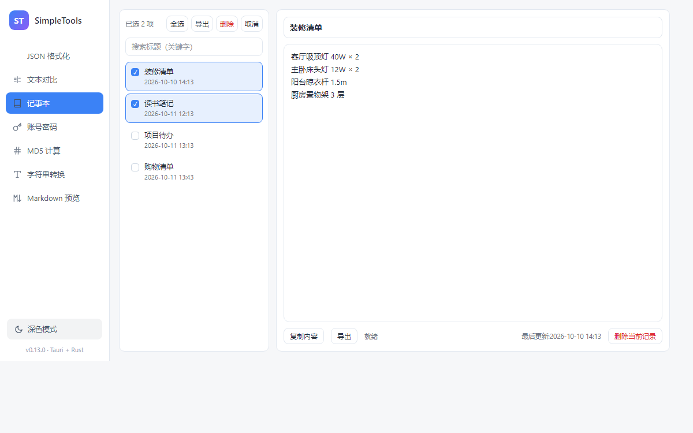

# SimpleTools

SimpleTools 是一款基于 Tauri 2 + Rust 的 Windows 桌面工具箱，安装体积小，数据默认保存在本机。

## 功能介绍

- 记事本：普通笔记、Markdown 笔记、任务笔记、全文搜索、图片和备份。
- 账号密码：本地分组管理、DPAPI 加密、Windows Hello 验证和批量导出。
- JSON：格式化、压缩、自动去转义、树形查看和历史记录。
- 文本对比：行级、字符级和 JSON 结构差异。
- Markdown：实时预览、目录、搜索和本地图片。
- 数据库：只读查询 SQLite，支持结构查看、智能提示和分页。
- 网络工具：HTTP/HTTPS 抓包、模拟服务器和局域网调试。
- 其他工具：MD5、字符串转换、二维码和时间戳等。

## 更新日志

版本变化统一维护在 [更新日志](CHANGELOG.md)。
